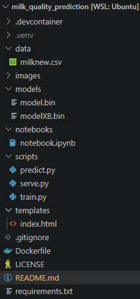
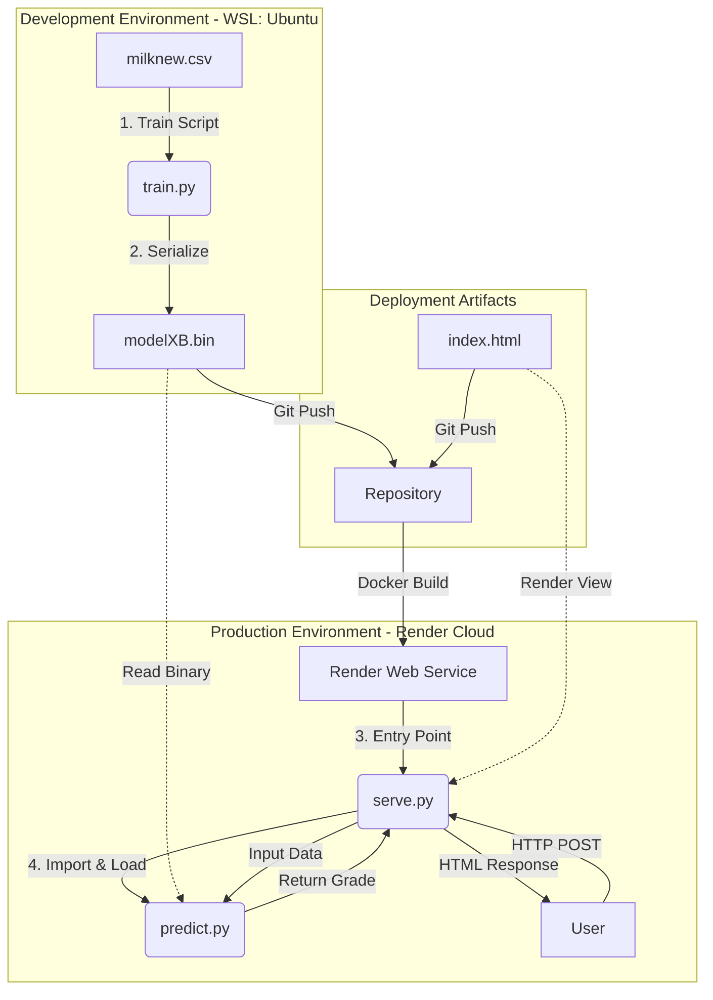
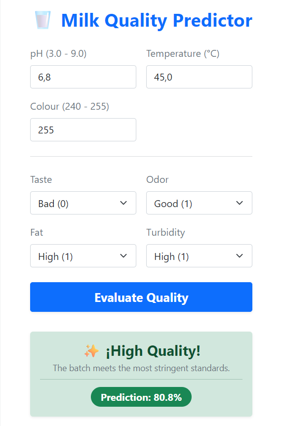

# Milk Quality Prediction

## Problem statement

In the food and dairy industry, ensuring the safety and quality of raw materials is critical. Milk is a highly 
perishable product prone to rapid bacterial growth and chemical degradation if stored or handled improperly. Relying 
solely on manual or delayed laboratory testing can lead to catastrophic waste, financial losses for producers, and 
severe public health risks. Incorporating automated machine learning systems at reception points allows for immediate 
risk mitigation.

The objective of this project is to build an automated quality control system that classifies raw milk into two 
categories: 

- **Target:** `Grade` (`1` for Premium Quality [High grade], `0` for Rejected Quality [Medium/Low grade]).
- **Features:** `pH`, `Temperature`, `Taste`, `Odor`, `Fat`, `Turbidity`, and `Colour`.

By analyzing instant physicochemical parameters collected by internet-of-things (IoT) sensors during milk reception, 
the machine learning model will predict whether a specific batch meets the industrial standards or needs to be 
discarded before entering the production line.

- **Dairy Processing Plants:** Reduces the risk of ruining entire production batches.
- **Quality Assurance (QA) Teams:** Streamlines the inspection workflow with instant decision-making.
- **Consumers:** Ensures higher safety standards and consistency in final dairy products.

The models evaluated in this project are:

* **Logistic Regression:** A machine learning model that uses logistic regression to predict the quality of milk.
* **Decision Tree Classifier:** A machine learning model that uses decision tree to predict the quality of milk.
* **Random Forest Classifier:** A machine learning model that uses random forest to predict the quality of milk.
* **Gradient Boosting Classifier:** A machine learning model that uses gradient boosting to predict the quality of milk.

To measure the success of our predictive models, as dataset target is mildly imbalanced (25%-75%) the primary evaluation
selected are:

* **ROC-AUC (Primary):** Since this is a mildly imbalanced classification task, Area Under the ROC Curve will be used to 
evaluate how well the model distinguishes between acceptable and rejected milk across all thresholds.
* **Accuracy (Secondary):** Used as a standard baseline metric for overall correctness.


## Dataset description

The dataset used for this project can be found in the `data` folder or can be downloaded from 
[Kaggle](https://www.kaggle.com/datasets/cpluzshrijayan/milkquality). This dataset consists of 7 independent variables 
ie pH, Temperature, Taste, Odor, Fat, Turbidity, and Color and the target variable is the qualityGrade of the milk. 
The description of the dataset is as follows:

- **pH**: pH of the milk which ranges from 3 to 9.
- **Temperature (C)**: Temperature of the milk which ranges from 34 to 90.
- **Taste**: Taste of the milk which is a categorical variable with 2 levels: 0 for Bad and 1 for Good.
- **Odor**: Odor of the milk which is a categorical variable with 2 levels: 0 for Bad and 1 for Good.
- **Fat**: Fat of the milk which is a categorical variable with 2 levels: 0 for Low and 1 for High.
- **Turbidity**: Turbidity of the milk which is a categorical variable with 2 levels: 0 for Low and 1 for High.
- **Colour**: Colour of the milk which ranges from 240 to 255.
- **Grade(target)**: Represents the quality of the milk. Is a categorical variable with 3 levels: low, medium and high.

### Data preparation:

- Column names has been changed to lowercase and spaces have been replaced with underscores. 
- Column temprature has been renamed to temperature. 
- In column fat has been removed a final space.
- Target column grade value has been changed to 0 for low and medium and 1 for high.

### Validation framework

The dataframe has been split into three parts:

- **Train dataset:** The dataset used to train the model. (60%)
- **Validation dataset:** The dataset used to evaluate the model's performance. (20%)
- **Test dataset:** The dataset used to evaluate the model's performance. (20%)

## EDA

### Data analysis

- There are no missing values in the dataset.
- The data is considered mildly imbalanced with a ratio of 75:25.
- Cols numerical are: pH, Temperature, Color.
- Cols categorical are: Taste, Odor, Fat, Turbidity.

### Risk Ratio Analysis

The Risk Ratio was evaluated to measure how much specific binary configurations increase the probability of a batch being downgraded to **Non-Premium Quality (Class 0)** relative to the global baseline (~75%):

*   **`odor` (Malo: 1.73 / Bueno: 0.40):** Defective odor is the strongest sensory indicator for disqualification. 
Conversely, a good odor profile acts as a massive statistical protector.
*   **`fat` (Bajo: 1.48 / Alto: 0.014):** Low fat content elevates the risk of premium rejection. An optimal/high fat 
configuration drops the rejection risk, proving that high fat is a mandatory biophysical requirement for premium 
categorization.
*   **`turbidity` (Alta: 1.30 / Baja: 0.70):** High turbidity increments the downgrade risk, acting as a physical proxy 
for protein instability or particle contamination at reception.
*   **`taste` (Malo: 1.20 / Bueno: 0.77):** A bad flavor profile increases the rejection risk, showing the weakest 
independent impact among all organoleptic variables.


### Mutual Information Insights

Based on the updated Mutual Information (MI) scores targeting Premium Quality (High Grade), a significant shift in 
feature dependency is observed compared to the previous baseline:

*   **`fat` (0.112955):** This feature now holds the highest Mutual Information score among all categorical variables.
 This indicates that fat content shares a strong global dependency with premium milk classification. Mechanistically, 
 achieving a premium industrial grade requires optimal, standardized fat percentages, making this feature a key 
 structural driver for the predictive models.
*   **`odor` (0.076114):** This feature demonstrates a moderate-to-high MI score. While odor was negligible when 
predicting basic spoilage, it becomes a crucial descriptor when isolating premium-grade milk, as perfect organoleptic 
properties are mandatory for high-tier products.
*   **`turbidity` (0.015025) and `taste` (0.007889):** These features display low MI scores, close to zero. On their 
own, knowing the specific turbidity or taste configuration provides very little global statistical information to 
determine if the milk reaches a premium status.

*Conclusion for Feature Selection:* While `fat` and `odor` are identified as the primary categorical anchors for 
isolating premium quality, `turbidity` and `taste` offer lower independent predictive power and will rely on 
combinations with continuous parameters during model training.

### Correlation Analysis

The linear relationship between the continuous features and the premium quality target was evaluated using the absolute 
Pearson correlation coefficients. The mild class imbalance configuration reveals the following dynamics:

*   **`temperature` (0.203598):** This feature displays a **weak but noticeable linear correlation**. Compared to the 
previous spoilage baseline, the correlation is lower because standard and premium milk can share similar stable storage 
temperatures. However, it remains the most dominant linear predictor among continuous variables, as strict thermal 
management is still a baseline requirement for high-grade dairy preservation.
*   **`colour` (0.088529):** It shows an **extremely weak linear correlation**, indicating that simple light 
reflectance shifts are insufficient to linearly separate standard-grade milk from premium-grade milk.
*   **`ph` (0.021939):** The absolute linear correlation for pH remains **almost non-existent** (close to 0). 

#### 💡 Critical Analytical Note on pH Non-Linearity:
Although pH is biochemically the ultimate indicator of dairy quality, its linear correlation score is near zero 
because **the underlying relationship remains strictly non-linear**. Premium milk requires an exceptionally narrow, 
perfect chemical window. If the pH is too low (acidic/spoiled) or too high (adulterated/mastitis), the batch falls into 
Class 0. Because premium milk is bounded by both an upper and a lower limit, linear correlation metrics fail to capture 
this windowed behavior. However, non-linear algorithms such as **Decision Trees**, **Random Forests**, and 
**Gradient Boosting** are mathematically equipped to map these thresholds natively.


## Modeling approach & metrics

Multiple machine learning algorithms—including **Logistic Regression**, **Decision Trees**, **Random Forests**, and 
**Gradient Boosting**—were tested, evaluating their structural hyperparameters (such as regularization strength $C$, 
tree depth, and learning rates) alongside classification decision thresholds to optimize performance based on 
industrial safety and waste constraints.

The table below summarizes the performance of each trained algorithm on the validation dataset after hyperparameter 
tuning:

| Model | Hyperparameters | Accuracy | ROC-AUC Score |
| :--- | :--- | :--- | :--- |
| **Logistic Regression** | solver=`lbfgs`, `C=10`, `max_iter=1000` | 0.868 | 0.924 |
| **Decision Tree** | `max_depth=5`, `min_samples_leaf=10` | 0.986 | 0.972 |
| **Random Forest** | `n_estimators=50`, `max_depth=3`, `min_samples_leaf=10` | 0.972 | 0.991 |
| **Gradient Boosting** | `eta=0.03`, `max_depth=3`, `min_child_weigh=1` | 0.972 | 0.995 |

The final model chosen for production deployment will be selected based on the highest **ROC-AUC Score** demonstrated 
in the performance summary table. This metric ensures maximum robust discriminative power across all operational 
classification thresholds. 

**Gradient Boosting** is identified as the optimal candidate. Consequently, this specific model 
structure has been retrained on the full development dataset (`df_full_train`) and evaluated against the final unseen 
testing dataset (`df_test`) to verify its generalization capabilities before being exported to production.

Final ROC-AUC score: **0.998**

## Architecture

### Project folder structure



- devcontainer: Contains the configuration files for the development environment.
- data: Contains the raw data used for training and testing.
- models: Contains the trained models.
- notebooks: Contains Jupyter notebooks for data exploration and analysis.
- scripts: Contains the Python scripts for training, testing, and serving the web service.
  - train.py: Contains the main logic for training the model and saving it to disk.
  - predict.py: Contains the main logic for making predictions.
  - serve.py: Contains the FastAPI server for serving the web service.
- templates: Contains the HTML templates for the web service.
- Dockerfile: Specifies the Docker configuration for the web service.
- requirements.txt: Lists the required Python packages for the project.
- README.md: Provides an overview of the project and instructions for running it.

### Architecture diagram



## How to run

### How to run locally

- Requirements. Make sure you have the following installed:
    - Python >3.10
    - pip >26.2

- Clone the repository from GitHub:
```bash
git clone https://github.com/maneldevs/milk_quality_prediction
```

- Create a virtual environment:
```bash
python -m venv .venv
```

- Activate the virtual environment:
```bash
source .venv/bin/activate
```

- Install dependencies:
```bash
pip install -r requirements.txt
```

- Be sure you are in the root directory of the project

- Run the training script:
```bash
python scripts/train.py
# Optionally, you can specify the data and model paths:
# python scripts/train.py --data data/milknew.csv --model models/model.bin
```

- Run the prediction script:
```bash
python scripts/predict.py
# Optionally, you can specify the model path:
# python scripts/predict.py --model models/model.bin
```

- The results will be printed to the console:
```
sample
-----
ph=6.8 temperature=45.0 taste=0 odor=1 fat=1 turbidity=1 colour=255
-----
prediction = 0.8080000281333923
Is High Grade = True
```

- Start the Web Service:
```bash
python scripts/serve.py
```

- Open the Web Service in your browser:
```bash
http://localhost:7860
```



- Optionally Test the Web Service from the command line:
```bash
curl -X POST -H "Content-Type: application/json" -d '{"ph": 6.8, "temperature": 45, "taste": 0, "odor": 1, "fat": 1, "turbidity": 1, "colour": 255}' http://localhost:7860/api/predict
```

- Response:
```json
{
  "prediction": 0.8080000281333923,
  "is_high_grade": true
}
```

- Deactivate the virtual environment:
```bash
deactivate
```

### How to run using Docker

- Requirements. Make sure you have the following installed:
    - Docker

- Clone the repository from GitHub:
```bash
git clone https://github.com/maneldevs/milk_quality_prediction
```

- Be sure you are in the root directory of the project

- Build the Docker image:
```bash
docker build -t milk_quality_prediction .
# this process can take several minutes
```

- Run the Docker container:
```bash
docker run --rm -p 7860:7860 milk_quality_prediction
```

- Open the Web Service in your browser:
```bash
http://localhost:7860
```


- Optionally Test the Web Service from the command line:
```bash
curl -X POST -H "Content-Type: application/json" -d '{"ph": 6.8, "temperature": 45, "taste": 0, "odor": 1, "fat": 1, "turbidity": 1, "colour": 255}' http://localhost:7860/api/predict
```

- Response:
```json
{
  "prediction": 0.8080000281333923,
  "is_high_grade": true
}
```

- Stop and delete the Docker container:
```bash
Pulse the Ctrl+C key
```

### How to run on the Cloud

- Open the Web Service in your browser:
```bash
https://milk-quality-prediction-hhwp.onrender.com
```


- Optionally Test the Web Service from the command line:
```bash
curl -X POST -H "Content-Type: application/json" -d '{"ph": 6.8, "temperature": 45, "taste": 0, "odor": 1, "fat": 1, "turbidity": 1, "colour": 255}' https://milk-quality-prediction-hhwp.onrender.com/api/predict
```

- Response:
```json
{
  "prediction": 0.8080000281333923,
  "is_high_grade": true
}
```

## Known limitations and next steps

While the developed predictive system demonstrates strong robustness and high discriminative capabilities, several 
architectural limitations have been identified along with strategic next steps to improve the pipeline for industrial 
production:

*   **Dataset Size and Diversity:** The model was trained on a relatively small tabular dataset under static 
environmental assumptions. Real-world dairy plants experience variations due to seasonal shifts, cow diets, and 
varying chemical compositions across different cattle breeds, which are not captured in the current feature space.
*   **Static Biochemical Thresholds:** High-capacity non-linear models (such as Gradient Boosting and Decision Trees) 
can over-rely on exact, crisp boundaries—particularly regarding pH cuts. In an industrial deployment, minor sensor
drift or uncalibrated IoT hardware could degrade classification performance significantly if values hover near these
hard limits.
*   **Binary Reduction Constraints:** Grouping both "Low" and "Medium" quality grades into a single rejected category
 simplifies the pipeline but discards nuances. Certain industrial processes can utilize medium-grade milk for specific 
secondary derivatives (e.g., powdered milk or industrial butter), meaning a binary approach limits operational 
optimization.

The following step to improve the system's performance and robustness could be:

*   **Transition to Multi-Class Classification:** Expand the target framework from binary to multi-class or 
hierarchical prediction. This will allow the system to separate premium-grade milk from usable standard-grade batches 
and highly contaminated or spoiled milk that requires immediate disposal.

*   **Use an industrial big dataset:** Utilize a large, diverse, and up-to-date dataset that includes real-world 
milk production and consumption scenarios. This will enable the system to learn from real-world data and adapt to 
changing conditions.